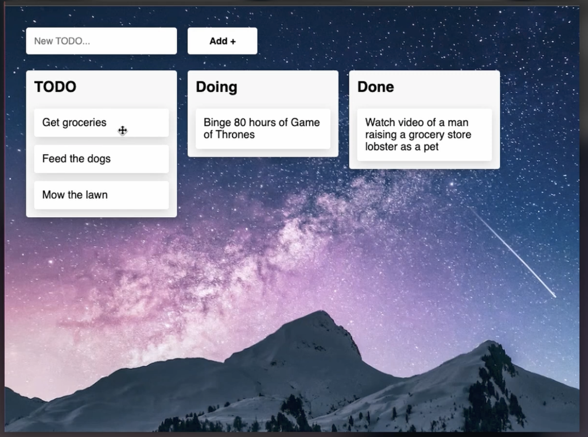
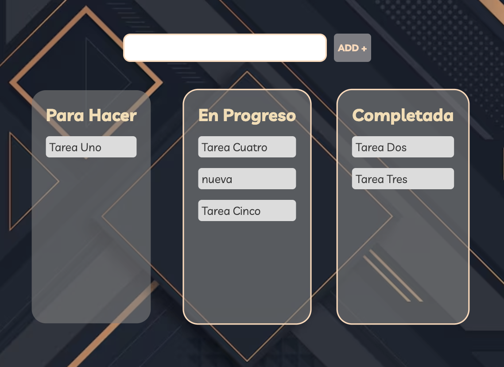

# App Tablero Kanban

## Canal: Tom is Loading

## Video:

[Aquí puedes ver el tutorial (Youtube)](https://www.youtube.com/watch?v=ecKw7FfikwI)

## Descripción:

Tablero kanban con un formulario para agregar tareas, tres columnas para ubicar las tareas y funcionalidad de **drag an drop**

### Funcionalidad adicional interesante:

1. _función para ubicar la tarea en cualquier lugar de la columna, no solo al final_

> Esta es una imagen de referencia inicial:



## Notas de Desarrollo:

- A los elementos (tasks) se les añade los eventos `dragstart` y `dragend` para agregar y eliminar la clase `selected` respectivamente.
- En este ejercicio no hubo necesidad de usar el `drop`; bastó con el `dragover`en las columnas para el `e.preventDefault()` y la función `sortElement()`
- Para solucionar el problema generado con `dragenter` y `dragleave` que se disparan al entrar y salir de CUALQUIER elemento hijo (es decir, cada vez que la tarjeta pasa por encima de otra tarjeta dentro de la columna) se verificó si realmente salía de la columna usando `e.relatedTarget`:

```javascript
column.addEventListener("dragleave", (e) => {
  if (column.contains(e.relatedTarget)) return;
  column.classList.remove("selected");
});
```

- Para evitar el cambio de tamaño en la columna cuando se agrega la clase `selected`se usa `outline` en lugar de `border`
- La lógica para arrastrar, soltar y ordenar está en el archivo `drag.js``
- La lógica para crear nuevas tareas está en el archivo `tasks.js`
- la función.

```javascript
export const attachDragEvents = (task) => {
  task.addEventListener("dragstart", (e) => {
    task.classList.add("dragging");
  });
  task.addEventListener("dragend", (e) => {
    task.classList.remove("dragging");
  });
};
```

> Esta es una imagen de referencia final:


